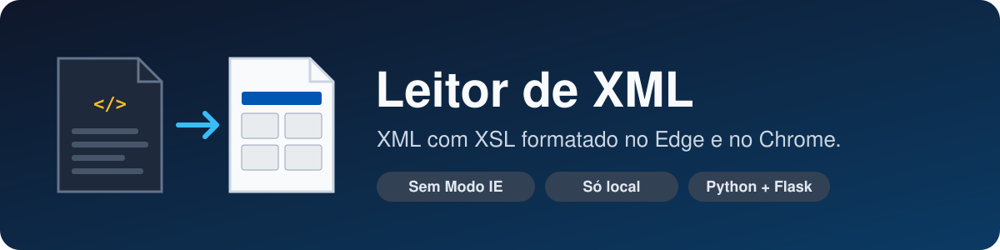
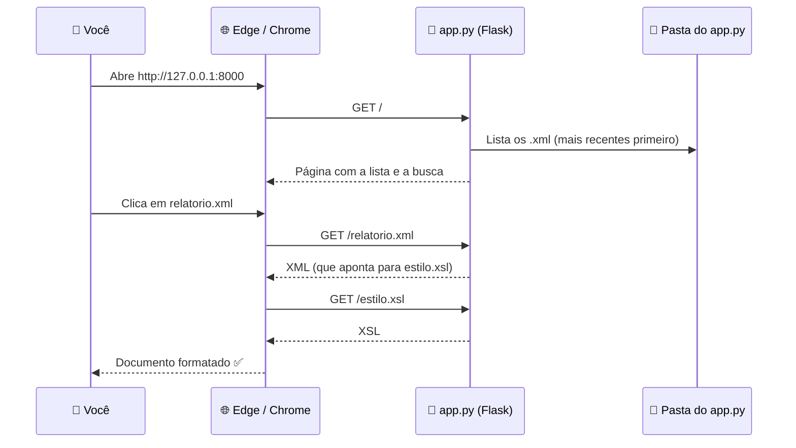

<p align="center">
  
</p>

<h1 align="center">🌐 Leitor de XML</h1>

<p align="center">
  <b>O XML abre formatado, sem tela em branco e sem Modo Internet Explorer.</b><br>
  Um servidorzinho local que entrega seus arquivos <code>.xml</code> e a folha de estilo <code>.xsl</code> pelo endereço <code>http://127.0.0.1:8000</code>, e o Edge ou o Chrome passam a mostrar o documento do jeito certo.
</p>

<p align="center">
  
  
  
  
</p>

<p align="center">
  <a href="#-instalação">📦 Instalar</a>
  &nbsp;·&nbsp;
  <a href="#-como-usar">🚀 Usar</a>
  &nbsp;·&nbsp;
  <a href="#-solução-de-problemas">🩹 Problemas</a>
</p>

---

## 📑 Sumário

- [🧐 O problema](#-o-problema)
- [✨ O que faz](#-o-que-faz)
- [🧭 Como funciona](#-como-funciona)
- [📋 Requisitos](#-requisitos)
- [📦 Instalação](#-instalação)
- [🚀 Como usar](#-como-usar)
- [🩹 Solução de problemas](#-solução-de-problemas)
- [❓ Perguntas frequentes](#-perguntas-frequentes)
- [🧰 Para quem mantém](#-para-quem-mantém)
- [📄 Licença e autor](#-licença-e-autor)

---

## 🧐 O problema

Alguns sistemas e equipamentos salvam relatórios em **XML** que dependem de uma folha de estilo **XSL** para aparecerem formatados. Aberto com duplo clique (`file:///...`), o Edge e o Chrome **bloqueiam a folha de estilo** por segurança, e o arquivo aparece em branco ou como um monte de código.

| Cenário | O que acontece |
| :--- | :--- |
| 📂 **Duplo clique no XML** | O navegador bloqueia o XSL. Tela em branco ou código cru. |
| 🧓 **Modo Internet Explorer** | Funciona, mas cada arquivo precisa entrar na lista de exceções do Edge. Trabalhoso. |
| ✅ **Com o Leitor de XML** | O arquivo é aberto por `http://127.0.0.1:8000`. O navegador carrega o XSL normalmente e mostra o documento formatado. |

---

## ✨ O que faz

| | Recurso | Em poucas palavras |
| :---: | :--- | :--- |
| 📋 | **Lista dos XML** | Página inicial com todos os `.xml` da pasta do programa, **mais recentes primeiro**, com data e hora. |
| 🔎 | **Busca instantânea** | Caixa de busca que filtra a lista pelo nome enquanto você digita. |
| 🎨 | **XSL carregado** | Entrega os `.xml` e os `.xsl` pelo mesmo endereço, então a folha de estilo referenciada no XML é aplicada. |
| 🔒 | **Só arquivos permitidos** | Pela rota de arquivos, só saem `.xml` e `.xsl`. Qualquer outra extensão recebe "tipo não permitido". |
| 🏠 | **Só neste computador** | Escuta apenas em `127.0.0.1`: ninguém da rede acessa. |

---

## 🧭 Como funciona



---

## 📋 Requisitos

| | Item | Observação |
| :---: | :--- | :--- |
| 🐍 | **Python 3** | Com o `pip`. |
| 🧪 | **Flask** | `pip install Flask`. |
| 🌐 | **Navegador moderno** | Edge, Chrome ou Firefox. |

---

## 📦 Instalação

```bash
git clone https://github.com/Nicker2/servidor-xml-ie-mode.git
cd servidor-xml-ie-mode
pip install Flask
```

Coloque os arquivos **na mesma pasta do `app.py`**:

```text
📁 servidor-xml-ie-mode
   ├── app.py               ← o servidor
   ├── relatorio_01.xml     ← seus XML
   ├── relatorio_02.xml
   ├── estilo.xsl           ← a folha de estilo que os XML usam
   ├── templates/
   │   └── index.html       ← página da lista
   └── static/
       └── style.css        ← visual da lista
```

---

## 🚀 Como usar

1. Na pasta do projeto, rode:

   ```bash
   python app.py
   ```

2. Espere aparecer `Running on http://127.0.0.1:8000`.
3. Abra **<http://127.0.0.1:8000>** no navegador.
4. Use a busca, se quiser, e clique no arquivo. Ele abre formatado.

Deixe a janela do console aberta enquanto usa. Para parar o servidor, pressione **Ctrl+C** nela.

> [!TIP]
> Novos XML colocados na pasta aparecem ao recarregar a página (F5). Não é preciso reiniciar o servidor.

---

## 🩹 Solução de problemas

| Sintoma | O que fazer |
| :--- | :--- |
| 📄 O XML abre sem formatação | Confira se o `.xsl` está **na mesma pasta** e com o **mesmo nome** que aparece na linha `<?xml-stylesheet ... href="..."?>` do XML. |
| 🚫 "Arquivo não encontrado ou tipo não permitido" | Só `.xml` e `.xsl` são entregues, e o nome precisa terminar exatamente assim (minúsculas). |
| 🙈 O arquivo não aparece na lista | A lista mostra só os `.xml` da pasta do `app.py`, sem subpastas. Mova o arquivo para lá e aperte F5. |
| 🔌 "Não é possível acessar esse site" | O servidor não está rodando. Abra o console e rode `python app.py` de novo. |
| ⛔ Porta 8000 ocupada | Outro programa usa a porta. Feche-o ou troque `port=8000` no fim do `app.py` (e use o novo número no endereço). |
| 🐍 `ModuleNotFoundError: No module named 'flask'` | Rode `pip install Flask`. |

---

## ❓ Perguntas frequentes

<details>
<summary><b>Preciso desligar a segurança do navegador?</b></summary>

Não. O navegador só bloqueia folhas de estilo de arquivos abertos direto do disco. Pelo endereço `http://127.0.0.1:8000`, ele trata o XML como uma página normal.
</details>

<details>
<summary><b>Outras pessoas da rede conseguem ver meus arquivos?</b></summary>

Não. O servidor escuta só em `127.0.0.1`, que é o próprio computador. Não troque esse endereço: o servidor roda com o modo de depuração do Flask ligado (veja [docs/AVANCADO.md](docs/AVANCADO.md#segurança)).
</details>

<details>
<summary><b>A data da lista é a de criação ou a de modificação?</b></summary>

No Windows, é a **data de criação** do arquivo na pasta. Um XML copiado hoje aparece com a data de hoje, no topo da lista.
</details>

---

## 🧰 Para quem mantém

| Documento | Conteúdo |
| :--- | :--- |
| 📘 [docs/AVANCADO.md](docs/AVANCADO.md) | Rotas do Flask, ordenação, segurança e personalização. |
| 📜 [docs/HISTORICO.md](docs/HISTORICO.md) | Histórico de alterações. |

Contribuições são bem-vindas: faça um **fork**, crie uma branch, faça as alterações e abra um **Pull Request** explicando o que mudou.

> [!CAUTION]
> Este repositório é **público**. Não envie XML reais de pacientes ou de clientes, nem para teste.

---

## 📄 Licença e autor

Este repositório ainda não tem arquivo de licença.

Criado por **Nicolas Bonza Cavalari Borges**.
